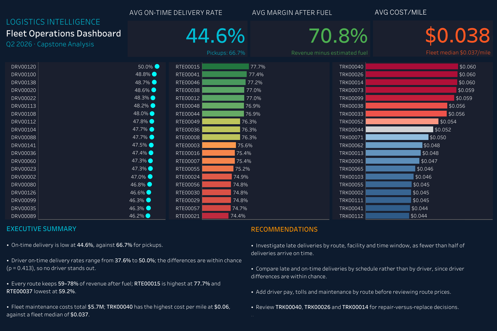

# Logistics Operations Performance Analysis

An end-to-end data analysis capstone project on a logistics operations database, investigating fleet efficiency, route profitability, and maintenance cost drivers across a 14-table relational dataset.



---

## Problem Statement

Logistics operations depend on the interaction of three variables — delivery reliability, route profitability, and fleet maintenance cost — yet these are often analysed separately.

This project consolidates a 14-table logistics database (85,000+ trip records) into a single analytical workflow to evaluate driver performance, route-level profitability, and fleet health, surfacing where operational issues may be eroding margin.

---

## Executive Summary

Only **44.6%** of deliveries arrived on time, against **66.7%** of pickups (55.7% across both). Driver on-time delivery rates range from 37.6% to 50.0%, and a chi-square test (p = 0.413) shows that spread is consistent with chance, so the delays are not explained by individual drivers.

With fuel cost estimated from gallons used on each trip, every route keeps **59–78%** of its revenue after fuel (median 72.0%). An earlier version reported a −609% margin on RTE00010; that came from fuel purchase records whose cost per trip has no relationship with trip distance, and it has been corrected.

Maintenance spend totals **$5.7M** across 120 trucks and is spread across the fleet: the costliest 10% of trucks account for 15.2% of spend. **TRK00040** has the highest cost per mile at about **$0.06**, against a median of $0.037.

---

## Business Questions

This project set out to answer:

- How reliable are pickups and deliveries?
- Do drivers differ in on-time delivery, fuel efficiency and revenue per mile?
- How much of each route's revenue remains after fuel?
- Where is maintenance cost concentrated across the fleet?
- Are there figures that point to a data-quality problem rather than genuine performance?

---

## Key Findings

**Delivery Reliability**
- On-time delivery rate: **44.6%** (pickups **66.7%**; both together 55.7%)
- Driver rates range from **37.6%** to **50.0%**; the differences are not statistically significant (chi-square p = 0.413)
- Every driver's fuel efficiency is between **6.45** and **6.57** MPG

**Route Profitability**
- Margin after fuel: **59.2%** (RTE00037) to **77.7%** (RTE00015), median **72.0%**
- Fuel cost is estimated as gallons used × the average price ($3.899/gallon), because fuel purchase cost per trip does not track distance (correlation 0.00 vs 0.98 for gallons used)

**Fleet Maintenance**
- Total maintenance spend: **$5.7M** across 120 trucks; the top 10% of trucks account for 15.2%
- **TRK00040** has the highest cost per mile at about **$0.06** (fleet median $0.037)

---

## Recommendations

- **Investigate late deliveries by route, distance, facility and time window.** Drivers do not differ by more than chance, so the next comparison is by route and schedule rather than by driver.
- **Add driver pay, tolls and maintenance by route before reviewing prices.** Margin after fuel is the only route-level measure the data supports.
- **Review TRK00040, TRK00026 and TRK00014 individually** for repair-versus-replace decisions.
- **Fix the link between fuel purchases and trips** so actual fuel cost can replace the estimate.

---

## Tools & Technologies

| Tool | Purpose |
|---|---|
| Python (pandas, matplotlib, seaborn, SciPy) | Data cleaning, analysis and statistical testing |
| Jupyter Notebook | Development environment |
| Tableau Public | Interactive dashboard |
| Git & GitHub | Version control |

---

## Dataset Overview

| Attribute | Value |
|---|---|
| Tables | 14 |
| Records | 85,000+ trips |
| Project Type | End-to-End Logistics Operations Analytics |

---

## Project Structure

```
logistics-analysis/
├── data/                              ← Raw CSV files (14 tables)
├── notebooks/
│   ├── 01_data_exploration.ipynb      ← Load all 14 tables, check nulls, verify FK relationships
│   ├── 02_cleaning.ipynb              ← Fix nulls, convert data types, export clean CSVs
│   └── 03_analysis.ipynb              ← Driver performance, route profitability, fleet health
├── exports/                           ← All 14 tables after 02_cleaning (three saved as *_clean.csv),
│                                         analysis results (analysis_*.csv) and chart PNGs
├── dashboard/
│   ├── logistics_dashboard.twbx       ← Tableau workbook
│   └── dashboard_preview.png
├── docs/
│   └── index.html                     ← Project page
├── LICENSE
└── README.md
```

---

## Dashboard

🔗 [View Live Dashboard](https://public.tableau.com/app/profile/taofeek.salami/viz/LogisticsOperation/LogisticsOperationsDashboard)

---

## Author

**Taofeek Salami**
Data Analyst | SQL | Python | Tableau

GitHub: [HarjiiBoss](https://github.com/HarjiiBoss)

---

## Corrections

**26 October 2026** (pull requests #1 and #2)

- **On-time rate:** the earlier README reported a 55.7% "on-time delivery rate". That figure combined pickups and deliveries. Deliveries alone are 44.6% on time and pickups 66.7%; the README now reports each. The comparison with a "95%+ industry benchmark" was removed, because no source for it was recorded.
- **Top driver:** DRV00108 (58.8%) was reported as the top driver. With deliveries measured on their own, driver rates range from 37.6% to 50.0%, and a chi-square test (p = 0.413) finds the spread consistent with chance, so no driver is singled out.
- **Route margins:** route fuel cost had been taken from fuel purchase records, whose cost per trip has no relationship with trip distance. That produced a −609% margin on RTE00010 and an 85.3% margin on RTE00044. Fuel is now estimated as gallons used × the average price, and every route keeps 59.2% to 77.7% of its revenue after fuel.
- **Dashboard, charts and project page** were rebuilt from the corrected analysis.
